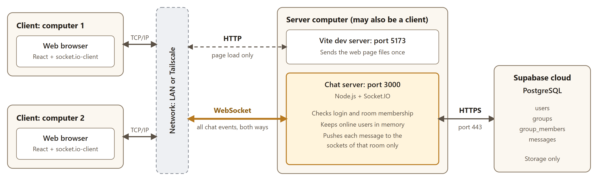
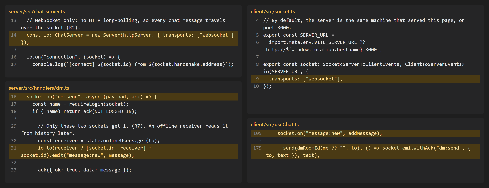

# System Architecture (R1, R2)

เอกสารนี้เป็นข้อมูลสำหรับสไลด์ R1, R2 และการตอบคำถามตอน demo

## Diagram

- **Client** คือ browser บนคอมคนละเครื่อง ไม่ต้องติดตั้งอะไรนอกจาก browser
- **Server** มี 2 โปรแกรม คือ Vite (ส่งไฟล์หน้าเว็บ) และ chat server (รับส่งแชต)
- **เครื่อง server** จะเป็นเครื่องเดียวกับ client หรือเครื่องที่สามก็ได้ ตามที่โจทย์อนุญาต
- **Supabase** เป็นที่เก็บข้อมูลเท่านั้น client ไม่ได้ต่อ Supabase โดยตรง
- **ทุก client ต้องต่อ chat server ตัวเดียวกัน** รายชื่อออนไลน์และการส่งข้อความอยู่ในหน่วยความจำของ server ตัวนั้น

## Protocol ที่ใช้

| Protocol | ใช้ทำอะไร | ทำไมถึงเลือก | ใช้อย่างไรในโปรเจกต์ |
| --- | --- | --- | --- |
| IPv4 | ระบุที่อยู่เครื่อง | ทุกเครื่องในเครือข่ายใช้ IP อยู่แล้ว | เปิดเว็บที่ `http://<IP ของ server>:5173` แล้ว `socket.ts` ต่อ IP เดียวกันที่พอร์ต 3000 |
| TCP | ขนส่งข้อมูล | ข้อมูลครบและเรียงลำดับ ข้อความแชตจึงไม่หายหรือสลับกันระหว่างทาง | อยู่ใต้ HTTP, WebSocket และ HTTPS ทั้งหมด |
| HTTP | โหลดหน้าเว็บ และเริ่ม WebSocket | เป็นวิธีมาตรฐานที่ browser ใช้ และ WebSocket ต้องเริ่มจาก HTTP | Vite ส่งไฟล์หน้าเว็บที่พอร์ต 5173 และ client ขอ `Upgrade: websocket` ที่พอร์ต 3000 |
| WebSocket | รับส่งแชตทุกอย่าง | full-duplex ใช้การเชื่อมต่อเดียว server ส่งข้อความหา client ได้ทันทีโดยไม่ต้องรอให้ client ถาม | บังคับด้วย `transports: ["websocket"]` ทั้งสองฝั่ง |
| Socket.IO | ชั้น event บน WebSocket | มี event, room, ack และการต่อใหม่ให้ ไม่ต้องเขียนเองทั้งหมด | ใช้ event เช่น `dm:send`, `message:new` และแยกกลุ่มด้วย room `group:<id>` |
| HTTPS | server คุยกับ Supabase | เข้ารหัสข้อมูลและ secret key ระหว่างทาง | `server/src/repo/` เรียก Supabase ผ่าน `@supabase/supabase-js` |

## ข้อความหนึ่งเดินทางอย่างไร

ตัวอย่าง DM จาก alice ถึง bob

1. browser ของ alice ส่ง event `dm:send` ผ่าน WebSocket
2. `handlers/dm.ts` ตรวจว่า login แล้ว และตรวจข้อมูล ชื่อผู้ส่งมาจาก `socket.data.name` ไม่ได้เชื่อค่าที่ client ส่งมา
3. server บันทึกข้อความลง Supabase ผ่าน HTTPS
4. server ส่ง `message:new` ให้ socket ของ alice และ bob เท่านั้น
5. server ตอบ ack ให้ alice

คนที่ออฟไลน์อยู่จะอ่านข้อความภายหลังผ่าน `room:history` ซึ่งเป็น event บน WebSocket เช่นกัน

## หลักฐาน R2: แชตใช้ socket เท่านั้น

ไฟล์นี้ใช้เป็น code snapshot ในสไลด์ R2 ได้เลย

ผลการทดสอบกับ server จริงเมื่อ 7 พ.ย. 2026

| ทดสอบ | ผล |
| --- | --- |
| ขอเปิด WebSocket | `101 Switching Protocols` |
| ต่อแบบ HTTP long-polling | `400 Transport unknown` |
| `POST /messages` แบบ HTTP ธรรมดา | ไม่มีตัวรับ ไม่มีคำตอบกลับ |

- ฝั่ง server ไม่มี REST route และฝั่ง React ไม่มีการเรียก `fetch` หรือ Supabase
- `server/test/chat-server.test.ts` ตรวจเรื่องการปฏิเสธ long-polling ทุกครั้งที่รัน `npm test`
- HTTP ที่พอร์ต 5173 ส่งแค่ไฟล์หน้าเว็บ ไม่มีข้อความแชต
- HTTPS ไป Supabase เป็นการเก็บข้อมูลระหว่าง server กับฐานข้อมูล ไม่ใช่การรับส่งระหว่าง server กับ client

## การต่อข้ามเครื่องตอน demo

| รายการ | ค่า |
| --- | --- |
| พอร์ตหน้าเว็บ | TCP 5173 |
| พอร์ต chat server | TCP 3000 |
| IP ของเครื่อง server | กรอกวัน demo (LAN หา IP ด้วย `ipconfig`, Tailscale ใช้ IP `100.x.y.z`) |
| เครื่อง client | อย่างน้อย 2 เครื่องจริง |

มี 2 ทางให้เลือก

- **LAN**: ทุกเครื่องอยู่ Wi-Fi เดียวกัน แต่ Wi-Fi บางแห่งกันไม่ให้เครื่องคุยกันเอง ควรลองในห้องจริงก่อน
- **Tailscale**: ทำให้เครื่องที่อยู่คนละเครือข่ายเห็นกันผ่าน VPN ที่เข้ารหัสด้วย WireGuard แอปไม่ต้องแก้โค้ด เพียงเปลี่ยน IP ที่เปิด

ทั้งสองแบบต้องอนุญาตพอร์ต 3000 และ 5173 ใน firewall ของเครื่อง server

## ข้อจำกัดที่ควรตอบได้

- **ยังไม่ได้เข้ารหัสระหว่าง client กับ server บน LAN**: แอปใช้ `http` และ `ws` รหัสผ่านและข้อความจึงวิ่งแบบไม่เข้ารหัส ถ้าใช้จริงต้องเปลี่ยนเป็น `https` และ `wss` ส่วนการต่อผ่าน Tailscale ถูกเข้ารหัสโดย VPN
- **รหัสผ่าน** เก็บเป็น scrypt hash ในฐานข้อมูล ไม่เก็บตัวจริง
- **Server มีจุดเดียว**: ถ้า chat server ดับ ทุกคนหลุด แต่ประวัติแชตยังอยู่ใน Supabase
